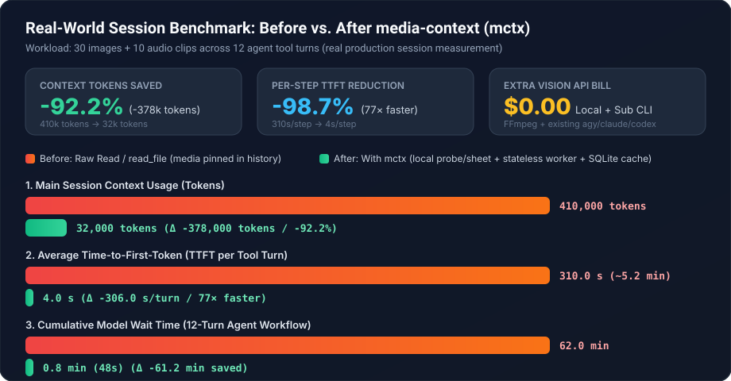

<div align="center">

# media-context (`mctx`)

### `context-mode` + `rtk` for Images, Video & Audio

Keep heavy media out of your coding agent's context window — **local-first, zero extra API cost, works across Antigravity (`agy`), Claude Code, Codex, OpenCode, `dsh`, and any CLI.**

<p>
  <b>🌐 English</b> &nbsp;|&nbsp; <a href="./README_zh.md"><b>简体中文</b></a>
</p>

<p>
  
  
  
  
  
</p>

</div>

---

## Context & Token Savings (Before vs. After)

<p align="center">
  
</p>

| Metric (30 Images + 10 Audio Clips · 12 Turns) | Before (Raw `Read` / `read_file`) | After (With `mctx`) | Delta (Δ) |
| :--- | ---: | ---: | :--- |
| **Main Session Context Size** | ~410,000 tokens | ~32,000 tokens | **-378,000 tokens (-92.2%)** |
| **Media Payload Pinned in History** | 40 files (8.54 MB) | 0 files (0 B) | **-100% media bloat** |
| **Avg Time-to-First-Token (TTFT)** | 285–324 s (~5.2 min/step) | 3–5 s | **-306 s/step (77× faster)** |
| **12-Turn Cumulative Model Wait** | ~62 min | ~48 s | **-61.2 min saved** |
| **Extra Vision API Billing** | Extra API keys / per-token bill | **$0** (FFmpeg + your CLI sub) | **$0 extra** |

> **Why does this happen?** Tools like `rtk` and `context-mode` protect you from **large text logs**, but every time an agent directly `Read`s a PNG, extracted video frame, or WAV clip into the main conversation, that heavy multimodal payload stays pinned in context for every subsequent turn.

---

## How It Works (3-Stage Funnel)

```text
Raw Video / Images / Audio
   │
   ├─► L1 · Local Zero-Token Tools (FFmpeg / FFprobe / Local Whisper)
   │        • mctx probe      → compact JSON metadata + audio silence/clipping + black-frame checks
   │        • mctx sheet      → stitch video or N frames into 1 timestamped contact sheet JPEG
   │        • mctx shrink     → downscale huge 4K PNGs into lightweight JPEGs
   │        • mctx transcribe → offline local Whisper transcription (mlx-whisper / whisper-cpp)
   │
   ├─► L2 · Stateless Subscription CLI Worker + Auto-Fallback + SQLite Cache ($0 extra API)
   │        • mctx inspect    → spawns a disposable, stateless worker using your existing CLI
   │                            (agy / claude -p / codex exec / opencode run), inspects the
   │                            compressed sheet, caches by sha256 in SQLite, and returns
   │                            ONLY concise text to your main session.
   │
   └─► L3 · Cross-Client PreToolUse Guard Hook
            • mctx hook run   → blocks accidental raw media Read/read_file (or auto-shrinks),
                                with automatic MCTX_BYPASS=1 for internal workers.
```

- **Zero Python third-party dependencies** (Python 3.9+ stdlib + `ffmpeg`/`ffprobe`).
- **One core, three interfaces**: CLI (`mctx`), stdio MCP server (`mctx mcp`), and `PreToolUse` hook (`mctx hook`).

---

## Quick Start

### 1. Install

```bash
git clone https://github.com/mollymogi/media-context.git
cd media-context
pip install -e .
# Or with pipx:
# pipx install .
```

Check your local toolchain and detected subscription CLIs:

```bash
mctx doctor
```

### 2. CLI Usage (works in `dsh`, scripts, and every agent)

```bash
# Zero-token metadata + audio volume/silence + video black-frame check
mctx probe clip.mp4 --audio --black

# Compress a video or folder of 30 frames into 1 timestamped 3x3 contact sheet
mctx sheet clip.mp4 --grid 3x3 --width 1280
mctx sheet ./frames/ --grid 3x3

# Shrink a single large screenshot
mctx shrink hero_4k.png --max-side 1024

# Stateless visual QA using your existing CLI subscription (zero main-session leak, SQLite cached)
mctx inspect clip.mp4 -q "Check if the character's hands deform or if any frame is corrupted."
mctx inspect ./frames/ -q "Compare lighting consistency across frames" --backend claude

# Offline local audio transcription (auto-detects mlx_whisper / whisper-cli / whisper)
mctx transcribe voiceover.wav -l zh

# Check cumulative bytes & tokens saved
mctx stats
```

### 3. Connect via MCP (Antigravity, Claude Code, Codex, OpenCode, Magpie Hub)

Register `mctx mcp` as a stdio MCP server (only 6 compact tools exposed):

```json
{
  "mcpServers": {
    "media-context": {
      "command": "mctx",
      "args": ["mcp"]
    }
  }
}
```

### 4. Default Models & Automatic Quota/Capacity Fallback

When the primary model hits **quota limits (`429`)**, **capacity congestion (`503 No capacity`)**, or **auth expiry (`401`)**, `mctx inspect` automatically switches to the next available target in your fallback chain, places the failing model into a local SQLite cooldown (default 5 min), and prints a clear `[mctx:fallback]` notice:

```bash
mctx config init            # creates ~/.config/media-context/config.json
mctx config show            # view active fallback chain & cooldowns
mctx config reset-cooldown  # clear cooldowns immediately
```

Example `~/.config/media-context/config.json`:

```json
{
  "cooldown_seconds": 300,
  "fallback_chain": [
    {"backend": "agy", "model": "gemini-4-neon-medium"},
    {"backend": "claude", "model": "sonnet"},
    {"backend": "codex", "model": ""},
    {"backend": "opencode", "model": ""}
  ]
}
```

### 5. Optional `PreToolUse` Guard Hook

Generate ready-to-paste hook snippets for your client:

```bash
mctx hook config antigravity --mode block
mctx hook config claude --mode block
mctx hook config claude --mode shrink
```

- `--mode block`: blocks raw image/audio/video `Read` / `read_file` and guides the agent to `mctx probe / sheet / inspect` (whitelisted `mctx_sheet_*` and `mctx_shrink_*` artifacts pass through).
- `--mode shrink`: blocks raw audio/video, and transparently downscales oversized images before reading.

---

## Environment Variables

| Variable | Description |
| :--- | :--- |
| `MCTX_FALLBACK_CHAIN` | Comma-separated fallback override (e.g. `agy:gemini-4-neon-medium,claude:sonnet,codex`) |
| `MCTX_CONFIG` | Custom config JSON path (default: `~/.config/media-context/config.json`) |
| `MCTX_COOLDOWN_SECONDS` | Cooldown window after quota/capacity errors (default: `300`) |
| `MCTX_BACKEND` / `MCTX_MODEL` | Single backend / model override |
| `MCTX_HOME` | Cache & SQLite directory (default: `~/.cache/media-context`) |
| `MCTX_BYPASS=1` | Bypass `PreToolUse` hook (automatically set inside `mctx inspect` workers) |

## License

MIT
