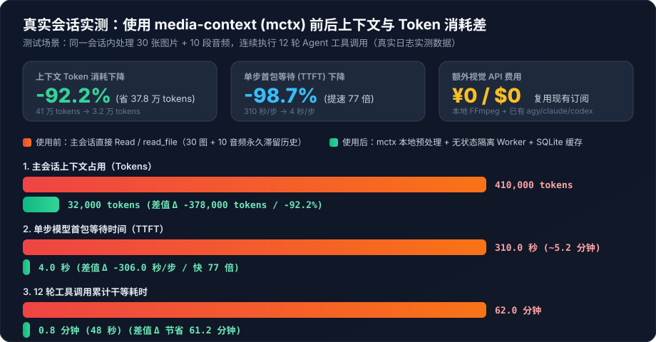

<div align="center">

# media-context (`mctx`)

### 面向图片、视频、音频的 `context-mode` + `rtk`

把重型多媒体文件挡在 Coding Agent 主会话上下文之外——**本地优先、0 额外 API 费用，全 CLI 通用（Antigravity / Claude Code / Codex / OpenCode / `dsh`）**。

<p>
  <a href="./README.md"><b>🌐 English</b></a> &nbsp;|&nbsp; <b>简体中文</b>
</p>

<p>
  
  
  
  
  
</p>

</div>

---

## 使用前后上下文与 Token 消耗对比

<p align="center">
  
</p>

| 指标（实测场景：30 张图 + 10 段音频 · 12 轮调用） | 使用前（直接 `Read` / `read_file`） | 使用后（接入 `mctx`） | 差值（Δ） |
| :--- | ---: | ---: | :--- |
| **主会话上下文占用** | ~410,000 tokens | ~32,000 tokens | **-378,000 tokens（-92.2%）** |
| **滞留在历史里的媒体文件** | 40 个文件（8.54 MB） | 0 个文件（0 B） | **-100% 媒体污染** |
| **单步首包等待时间（TTFT）** | 285–324 秒（~5.2 分钟/步） | 3–5 秒 | **-306 秒/步（快 77 倍）** |
| **12 轮任务累计模型等待** | ~62 分钟 | ~48 秒 | **节省 61.2 分钟** |
| **额外视觉 API 账单** | 需单独买 API Key / 按量计费 | **¥0**（FFmpeg + 已有订阅 CLI） | **0 额外费用** |

> **为什么会这样？** `rtk` 和 `context-mode` 解决了**大段文本/日志**撑爆上下文的问题，但一旦主会话直接 `Read` 了几十张抽帧图或几段 WAV/MP3，这些多模态块就会永久钉在对话历史里，后面哪怕只执行一条 1 秒钟的 `ls` 命令，每次都要背着几十万 tokens 重跑。

---

## 工作原理（三级漏斗，0 额外 API 账单）

```text
原始视频 / 图片 / 音频
   │
   ├─► L1 · 纯本地零 Token 工具（FFmpeg / FFprobe / 本地 Whisper）
   │        • mctx probe      → 极简 JSON 元数据 + 音频静音/爆音检测 + 视频黑屏检测
   │        • mctx sheet      → 把视频或几十张抽帧图拼成 1 张带时间戳的宫格缩略图
   │        • mctx shrink     → 把 4K 超大原图自动压缩为 ≤1024px 轻量 JPG
   │        • mctx transcribe → 离线本地转写（自动探测 mlx-whisper / whisper-cpp）
   │
   ├─► L2 · 无状态订阅 CLI Worker + 自动降级链 + SQLite 缓存（0 额外账单）
   │        • mctx inspect    → 拉起一次性无历史上下文的订阅 CLI 子进程
   │                            （agy / claude -p / codex exec / opencode run），
   │                            看完宫格图后立即销毁，按 sha256 缓存到 SQLite，
   │                            只把极简文字结论返回主会话。
   │
   └─► L3 · 跨客户端 PreToolUse 硬防线 Hook
            • mctx hook run   → 拦截主会话手滑直读原图/音视频（支持 block 或自动 shrink），
                                内部 Worker 自动携带 MCTX_BYPASS=1 防递归。
```

- **纯 Python 3.9+ 标准库，零第三方依赖**（只需本机有 `ffmpeg` / `ffprobe`）。
- **一套内核，三种形态**：标准 CLI（`mctx`）、stdio MCP Server（`mctx mcp`）、多客户端 `PreToolUse` Hook（`mctx hook`）。

---

## 快速开始

### 1. 安装

```bash
git clone https://github.com/mollymogi/media-context.git
cd media-context
pip install -e .
# 或使用 pipx：
# pipx install .
```

检查本地依赖与已探测到的订阅 CLI：

```bash
mctx doctor
```

### 2. CLI 常用命令（`dsh`、脚本及任意 Agent 均可直接调用）

```bash
# 零 token 元数据 + 音频响度/静音检测 + 视频黑屏检测
mctx probe clip.mp4 --audio --black

# 把整段视频或几十张抽帧目录拼成 1 张带时间戳的 3×3 宫格缩略图
mctx sheet clip.mp4 --grid 3x3 --width 1280
mctx sheet ./frames/ --grid 3x3

# 压缩单张超大截图
mctx shrink hero_4k.png --max-side 1024

# 复用已有订阅 CLI 做无状态隔离质检（主会话 0 媒体残留，SQLite 缓存）
mctx inspect clip.mp4 -q "检查人物手部是否穿帮、画面有无闪烁"
mctx inspect ./frames/ -q "对比各帧光影是否一致" --backend claude

# 本地免费离线音频转写（自动探测 mlx_whisper / whisper-cli / whisper）
mctx transcribe voiceover.wav -l zh

# 查看累计节省的字节数与 Token 统计
mctx stats
```

### 3. 通过 MCP 接入（Antigravity / Claude Code / Codex / OpenCode / Magpie）

在你的客户端或 `magpie` MCP Hub 中注册一个 stdio 服务（仅暴露 6 个精简工具）：

```json
{
  "mcpServers": {
    "media-context": {
      "command": "mctx",
      "args": ["mcp"]
    }
  }
}
```

### 4. 默认模型与额度/容量自动降级链

当主模型遇到**额度耗尽（`429` / `quota`）**、**服务端无容量（`503 No capacity`）**或**登录失效（`401`）**时，`mctx inspect` 会自动按降级链切换到下一个可用订阅 CLI，将失败模型放入本地 SQLite 冷却期（默认 5 分钟），并在结果中给出明确的 `[mctx:fallback]` 提示：

```bash
mctx config init            # 生成 ~/.config/media-context/config.json
mctx config show            # 查看当前降级链与冷却状态
mctx config reset-cooldown  # 立即清除所有冷却状态
```

示例 `~/.config/media-context/config.json`：

```json
{
  "cooldown_seconds": 300,
  "fallback_chain": [
    {"backend": "agy", "model": "gemini-4-neon-medium"},
    {"backend": "claude", "model": "sonnet"},
    {"backend": "codex", "model": ""},
    {"backend": "opencode", "model": ""}
  ]
}
```

### 5. 可选：`PreToolUse` 硬防线 Hook

一键生成各客户端 Hook 配置片段：

```bash
mctx hook config antigravity --mode block
mctx hook config claude --mode block
mctx hook config claude --mode shrink
```

- `--mode block`：拦截主会话直读原图/音视频，并提示改用 `mctx probe / sheet / inspect`（白名单 `mctx_sheet_*` 与 `mctx_shrink_*` 自动放行）。
- `--mode shrink`：拦截音视频直读，对超大原图在后台透明压缩后再放行读取。

---

## 环境变量

| 变量名 | 说明 |
| :--- | :--- |
| `MCTX_FALLBACK_CHAIN` | 逗号分隔的降级链覆盖（如 `agy:gemini-4-neon-medium,claude:sonnet,codex`） |
| `MCTX_CONFIG` | 自定义配置文件路径（默认 `~/.config/media-context/config.json`） |
| `MCTX_COOLDOWN_SECONDS` | 额度/容量失败后的冷却时长（默认 `300` 秒） |
| `MCTX_BACKEND` / `MCTX_MODEL` | 单个后端 / 模型覆盖 |
| `MCTX_HOME` | 缓存与 SQLite 数据库目录（默认 `~/.cache/media-context`） |
| `MCTX_BYPASS=1` | 跳过 `PreToolUse` Hook（`mctx inspect` 内部 Worker 自动设置） |

## 开源协议

MIT
